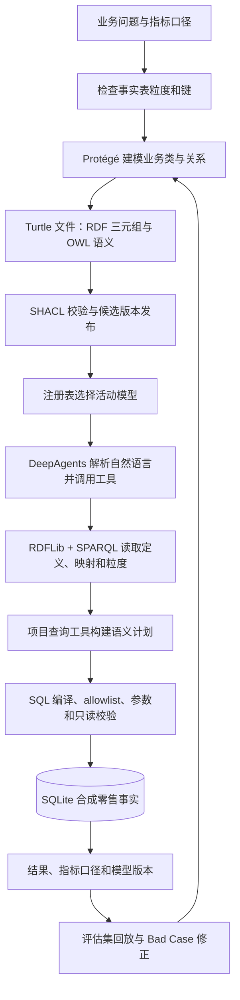
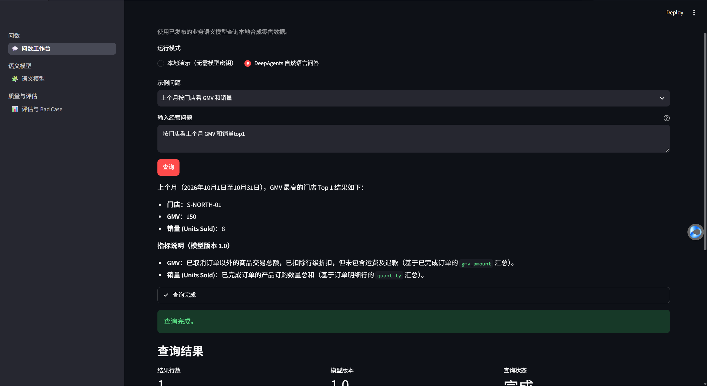

# ChatBI Lab

ChatBI Lab 是一个探索本体如何增强 ChatBI 的开源实验项目，以合成零售数据为实验场，实践 AI-native、Agent-native 的问数与评估流程。项目覆盖业务概念建模、RDF/OWL 本体、SHACL 校验、版本发布和 DeepAgents 自然语言问数。

## 从建模到 Agent 回答



## 技术角色

| 技术 | 在项目中的作用 |
| --- | --- |
| Protégé | 图形化查看和编辑 OWL 本体；当前版本文件可用 Protégé 打开 |
| RDF / Turtle | 用三元组保存业务概念、关系、指标定义和表字段映射 |
| OWL | 用 RDF 词汇表达类、属性、关系及正式语义 |
| SHACL / pySHACL | 检查每个发布模型是否具备必需的映射、定义与粒度 |
| SPARQL / RDFLib | 从已发布 RDF 图读取指标、维度、字段和 Join 信息 |
| SQL / SQLite | 查询合成订单记录；分别按订单和订单明细粒度聚合 |
| DeepAgents | 编排自然语言理解、语义工具调用、查询工具调用和回答 |
| 项目自有 Python 工具 | 解析本体、编译安全 SQL、执行查询、附上结果依据和版本 |

RDF 是图数据模型，OWL 是用 RDF 表达本体含义的词汇和语义；SPARQL 查询 RDF 图，SHACL 校验图是否符合结构约束。SQL 则查询关系数据库中的业务记录。详见[学习路线](#学习路线)。

## 本地快速开始

需要 Python 3.11 或更高版本。PowerShell 命令如下：

```powershell
py -3.11 -m venv .venv
.venv\Scripts\python.exe -m pip install -i https://pypi.tuna.tsinghua.edu.cn/simple -r requirements.txt
.venv\Scripts\python.exe scripts\init_db.py
.venv\Scripts\python.exe scripts\validate_model.py
.venv\Scripts\python.exe scripts\model_registry.py select
```

首次使用若注册表没有活动版本，先运行：

```powershell
.venv\Scripts\python.exe scripts\model_registry.py bootstrap 1.0
```

不需要模型服务密钥即可运行本体计划和完整查询演示：

```powershell
.venv\Scripts\python.exe -m app.semantic --metric GMV --metric UnitsSold --dimension Store
.venv\Scripts\python.exe -m app.demo --as-of 2026-11-02 "按门店看上个月 GMV 和销量"
```

预期结果是北城门店 GMV 150、销量 8；南城门店 GMV 70、销量 3。演示日期固定为 2026-11-02，因此“上个月”是 2026 年 10 月。

## 浏览器工作台



启动本地 Streamlit 页面（只监听本机回环地址）：

```powershell
.venv\Scripts\python.exe -m streamlit run app\ui.py --server.address 127.0.0.1
```

打开 Streamlit 输出的本地地址，通常是 `http://127.0.0.1:8501`。工作台包含三个页面：

- **问数工作台**：选择示例问题，在演示模式查看结果、指标口径、语义计划和 SQL。演示模式不需要模型密钥；选择 DeepAgents 模式时，页面会提示所需配置。
- **语义模型**：检查活动/已发布版本、指标定义、粒度、维度和数据映射，运行 SHACL 校验；切换已发布版本前需要明确确认。
- **评估与 Bad Case**：运行黄金问题集，查看分类通过率、逐题结果及 Bad Case 的版本、语义计划、SQL（若生成）和预期修正。

需要使用 DeepAgents 自然语言 Agent 时，按下方说明配置阿里云百炼 `.env` 并填写 `DASHSCOPE_API_KEY`。不填密钥也可以直接使用问数工作台的演示模式，以及语义模型和评估页面。

UI 和命令行 Agent 共用此配置。将 `.env.example` 复制为 `.env`，填入模型服务密钥和需要的模型设置：

```powershell
Copy-Item .env.example .env
# 编辑 .env 后运行
.venv\Scripts\python.exe -m app.agent "按门店看上个月 GMV 和销量"
```

默认设置为 `openai:qwen-plus`，通过百炼 OpenAI 兼容接口调用。若使用其他百炼地域、业务空间或计费方案，请按控制台提供的地址调整 `OPENAI_BASE_URL`；模型与 API Key、Base URL 必须属于匹配的服务配置。`.env` 已加入忽略列表，不要提交密钥。

## 模型生命周期

```powershell
# 首次登记并发布仓库中的 1.0 模型
.venv\Scripts\python.exe scripts\model_registry.py bootstrap 1.0

# 从 ontology/versions/1.0 复制一份到 ontology/candidates/1.1 并编辑 Turtle 后：
.venv\Scripts\python.exe scripts\model_registry.py register 1.1 --source ontology\candidates\1.1
.venv\Scripts\python.exe scripts\model_registry.py validate 1.1
.venv\Scripts\python.exe scripts\model_registry.py publish 1.1
.venv\Scripts\python.exe scripts\model_registry.py select

# 恢复一个以前发布过的模型版本
.venv\Scripts\python.exe scripts\model_registry.py rollback 1.0
```

候选版本需通过 SHACL 才能发布。验证报告与活动版本记录在 `ontology/registry.json`。详见[模型校验与版本发布](docs/learning/03-validation-and-versioning.md)。

## 评估和 Bad Case

```powershell
.venv\Scripts\python.exe scripts\evaluate_agent.py
```

黄金问题集在 `data/evaluation/cases.json`，摘要写入 `data/evaluation/latest-summary.json`，无法解析或需要澄清的案例及粒度风险保存在 `data/evaluation/bad-cases.jsonl`。修改本体、指标或 SQL 规划后，重新执行评估并检查失败案例。

## 学习路线

按这个顺序阅读，每一章都会链接到可运行的项目文件：

1. [关系数据、表粒度、Join 与指标](docs/learning/01-relational-data-model.md)
2. [RDF、OWL 与 Turtle](docs/learning/02-rdf-owl-turtle.md)
3. [SHACL 校验、模型版本与发布](docs/learning/03-validation-and-versioning.md)
4. [SPARQL 查询与 SHACL 校验](docs/learning/04-sparql-and-shacl.md)
5. [DeepAgents、语义规划与安全 SQL](docs/learning/05-deepagents-text-to-sql.md)
6. [评估与 Bad Case 迭代](docs/learning/06-evaluation-and-bad-cases.md)

领域问题与口径见 [`docs/domain/competency-questions.md`](docs/domain/competency-questions.md)；本体文件位于 [`ontology/versions/1.0/`](ontology/versions/1.0/)；建表和合成数据分别在 [`data/schema.sql`](data/schema.sql) 与 [`data/seed.sql`](data/seed.sql)。

## 范围与限制

当前支持 GMV、订单数、销量，按门店、商品或日期查询；GMV 不支持商品维度，因为订单级 GMV 尚无可靠的商品分摊定义。示例 SQL 只读，数据量很小，重点是展示语义模型怎样约束 Agent 的查询决策，不代表生产数据平台或生产权限方案。
